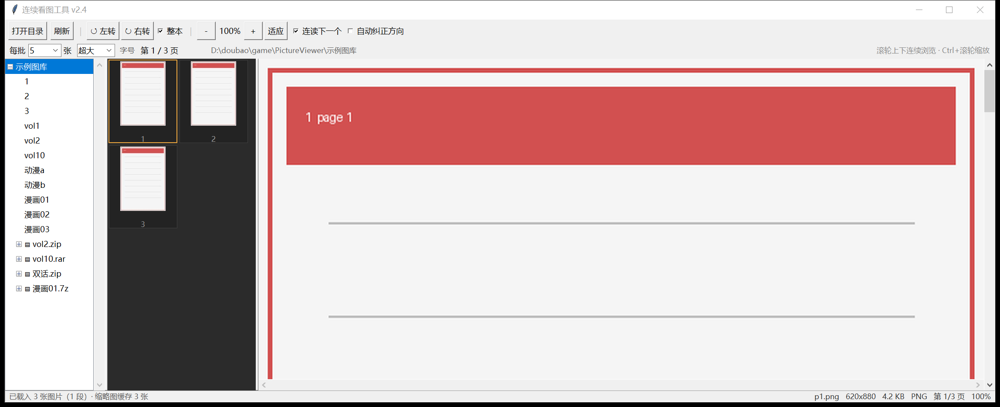

# 连续看图工具 · Comic Strip Viewer

一个专门用来看漫画、图集、扫描页的 Windows 桌面看图器（Windows 7 / 10 可用）：左边目录树、中间缩略图、右边一整条连续长图，滚轮往下滚就像翻书一样一路读下去。纯 Python + tkinter，没有 Electron、没有浏览器内核，几十 MB 内存就能开几百页的漫画。



## 特性

**1. 文件夹天然按“顺序”排**
自写 `natural_key()`：名字切成「文字段 / 数字段」，数字段按数值比较。

```
1  2  3            vol1  vol2  vol10       漫画01  漫画02  漫画10      动漫a  动漫b
```

`vol1 / vol10 / vol100` 不会再挤在一起，`第1话 / 第10话` 也按人的直觉排。

**2. 三栏布局，缩略图存本地**
左栏目录树懒加载（点开才扫子目录），中间缩略图，右边阅读区。缩略图写到程序目录的 `thumbcache\`，文件名是「路径 + 修改时间 + 大小」的哈希 —— 图没改就秒开，改了自动重做。

**3. 连续长图，页页紧贴**
同一文件夹的所有页按窗口宽度缩放后，一张接一张排成一张超长画布，**页与页之间 0 间隙**。滚轮 / ↑↓ / PageUp·PageDown 连续滚；只解码视口附近页面（上下各多备一页）；超长竖图（网漫那种 800×12000）自动切 1000px 一片，避免一口气吃掉几百 MB。

**4. 压缩包直接看**
目录树里 `zip / cbz / rar / cbr / 7z` 和文件夹并列（名字前带 `▤`），点一下自动解压并浏览：
- zip / cbz 走 Python 自带 zipfile，顺带修了 Windows 打包的 GBK 中文名乱码
- rar / cbr 调 WinRAR 的 `UnRAR.exe`，7z 调 `7z.exe`（自动在 Program Files、`D:\tool\7-Zip`、App Paths 注册表里找），缺一个会互相回退
- 解压结果缓存在 `extract_cache\`，同一个包第二次点开是秒开

**5. 旋转与缩放**
`↺ 左转` `↻ 右转` 转当前页，勾上**整本**就整个文件夹/压缩包一起转（扫歪的整本漫画一键摆正），缩略图同步跟转。`－ / ＋` 或 **Ctrl+滚轮** 在 40%–400% 缩放，`适应` 回到按窗宽显示。旋转只是阅读视角，**原图一个字节都不动**。

**6. 读完自动接下一本（连读）**
读到当前文件夹/压缩包最后一页，再往下滚一格，会自动把**同一浏览层级里的下一个**接着拼在同一条长图上，不用手动切文件、也不会打断滚动位置：
- **顺序跟目录树一致**：本身有图 → 先读完自己，再按自然顺序进子目录；子目录读完才轮到同级的下一个文件夹/压缩包（`1 → 2 → 3 → vol1 → vol2 → vol10`，`vol1` 绝不会和 `vol10` 挨在一起）
- **不跳层**：从某一卷里读完，接的是它所在那一层里紧邻的下一卷，不会跳到上级目录，也不会把当前目录自己再拼一遍
- **包内接着读**：一个 `zip`/`rar`/`7z` 里有多话（多个含图子目录）时，先读第 1 话，往下滚自动接包内第 2 话，包内读完才跳到外面下一个包
- **点父目录也能读**：选中一个自己没有图片、只装着图片文件夹的目录，会自动进第一个有图的子目录开始读，并往下接
- 下一个是压缩包就现场解压再拼上来（缓存过就是秒接）
- 接上的每一段都记在自己的区间里，「整本旋转」只作用于当前这一段，不会把后面接上的一起转
- 工具栏 `连读下一个` 可关掉，关掉后读到末尾就停住

## 环境要求 / Requirements

| 项目 | 要求 | 说明 |
|---|---|---|
| 操作系统 | Windows 7 SP1 / 10 / 11（64 位） | 需要 tcl/tk 8.6；已在 Win7 目标下用 Python 3.8.10 打包验证路径 |
| Python | **3.8 – 3.13** | Win7 上只能用 3.8.10（官方支持 Win7 的最后一版）；Win10/11 可用新版 |
| tkinter | 必装，随 Python 官方安装包勾选 `tcl/tk and IDLE` | 缺失时启动器会提示「没有找到可用的 Python」 |
| Pillow | **≥ 8.0**（建议最新版） | 唯一第三方依赖：`pip install pillow`；`Image.Resampling` / `Image.Transpose` 缺失时自动回退老 API |
| 内存 | 建议 ≥ 2 GB 空闲 | 视口附近才解码，通常只占几十 MB；超长竖图按 1000px 分片 |
| rar / cbr | WinRAR（`UnRAR.exe` / `Rar.exe`）或 7-Zip | 自动查 `Program Files\WinRAR`、`D:\tool\7-Zip`、App Paths 注册表、PATH；缺了会回退到另一个 |
| 7z | 7-Zip（`7z.exe`） | 同样自动查找；没有 WinRAR 时 rar 也可用 7z 解 |
| zip / cbz | 无外部依赖 | 走 Python 标准库 `zipfile`，含 GBK 文件名修复 |
| 打包 exe | PyInstaller（可选） | Win7 目标需 Python 3.8.10 + PyInstaller ≤ 4.10；Win10/11 用新版即可 |
| 磁盘 | 首次打开会生成缓存 | `thumbcache\` 缩略图、`extract_cache\` 解压缓存，都可随时删除 |

没有外部依赖的部分全部是标准库：`zipfile` / `subprocess` / `hashlib` / `threading` / `tkinter`。除 Pillow 外不需要 `pip install` 任何东西；不联网也能用（只看本地文件）。

## 运行

需要 Python 3.8+（Win7 用 3.8.10）和 Pillow：

```bat
pip install -r requirements.txt
```

也可以直接：

```bat
pip install pillow
```

双击 `启动.bat`（自动找本机可用的 Python），或直接：

```bat
python 看图工具.pyw
```

命令行还能直接带目录或压缩包：

```bat
python 看图工具.pyw "D:\漫画\火影"
python 看图工具.pyw "D:\漫画\vol1.rar"
```

打包成单文件 exe：双击 `打包exe.bat`（需 `pip install pyinstaller`），输出 `dist\看图工具.exe`。要在 Windows 7 上运行，用 Python 3.8.10 + PyInstaller 4.10 打包。

## 自检

```bat
python 自检.py
```

会生成一个「示例图库」（11 个演示文件夹 + zip/rar/7z 三种压缩包），并校验自然排序、缩略图缓存、三种压缩包解压、整本旋转、缩放、连续长图排版，最后无窗口跑一遍界面。

## 目录

```
看图工具.pyw     主程序
启动.bat         启动器（自动探测 Python）
打包exe.bat      打包单文件 exe
自检.py          一键自检
使用说明.md      中文详细说明
示例图库\        演示素材（含 vol2.zip / vol10.rar / 漫画01.7z）
thumbcache\      缩略图缓存（可删）
extract_cache\   解压缓存（可删）
```

## 说明

- 所有缓存在程序目录，删掉只会慢一次，不影响原文件
- 加密压缩包不支持
- 旋转、缩放是阅读状态，不写入原图
- 仅在 Windows 上验证（tkinter + Win32 API 取 DPI）；Linux/macOS 上理论上可跑，滚轮事件需另接 `<Button-4/5>`
